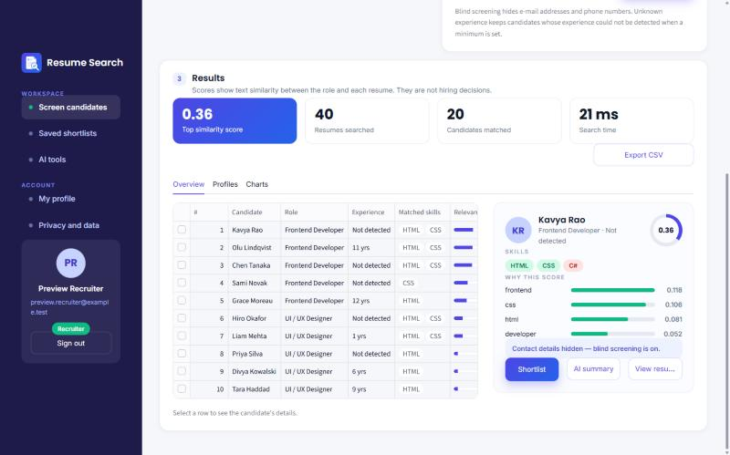
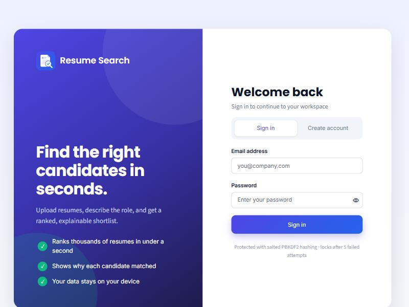

<p align="center">
  
</p>

<p align="center">
  Rank resumes against a role in seconds, see <em>why</em> each candidate matched,
  and keep your data on your own machine.
</p>

---

## What it does

Resume Search is a Streamlit web app for screening resumes. Upload a CSV dataset (or individual
PDF, DOCX and TXT resumes), describe the role with a job title, skills or a full job description,
and get a ranked, explainable shortlist. Ranking uses TF-IDF and cosine similarity, which runs
locally and needs no internet connection. Optional Google Gemini tools can summarise a resume,
compare it with a job description, or draft a job description. They only run when you press a
button.



<details><summary>Sign-in page</summary>



</details>

## Features

- **Fast ranking**: the search index is built once per file; each search only transforms the query.
- **Explainable scores**: "Why this score" lists the terms that contributed most to the score.
- **Skill matching** with aliases (Node.js / NodeJS, ML / Machine Learning, JS / JavaScript,
  PostgreSQL / Postgres). `C` never matches `C++` or `C#`, and `Java` never matches `JavaScript`.
- **Experience detection** for phrases like "5+ years", "over 5 years" and "experience of 5 years".
  It ignores graduation years. A toggle controls candidates whose experience is unknown.
- **Job description ranking**: paste a full job description to rank against it.
- **Blind screening** hides e-mail addresses and phone numbers in the display and in exports.
- **Roles**: recruiters rank whole datasets and save shortlists. Job seekers check their own resume
  against a job description.
- **Formula-safe CSV export** of results and shortlists.
- **Optional hybrid ranking** that mixes TF-IDF with sentence embeddings (`all-MiniLM-L6-v2`).
- **Secure local accounts**: PBKDF2-HMAC-SHA256 with 600,000 iterations, lockout after 5 failed
  attempts, and a 30-minute inactivity timeout.

## Setup

Requires Python 3.10–3.12.

### Windows (PowerShell)

```powershell
py -3.12 -m venv .venv
.\.venv\Scripts\python.exe -m pip install -r requirements.txt
.\.venv\Scripts\python.exe -m streamlit run app.py
```

### Linux / macOS

```bash
python3 -m venv .venv
source .venv/bin/activate
pip install -r requirements.txt
streamlit run app.py
```

The app opens at <http://localhost:8501>. Create an account on the sign-in page. Accounts live in
a local SQLite file (`resume_search.db`, or the path in `RESUME_SEARCH_DB`).

### Optional extra: hybrid ranking

```bash
pip install sentence-transformers      # installs PyTorch; the model download is about 90 MB
```

PDF and DOCX uploads use `pypdf` and `python-docx`, which `requirements.txt` already includes.

### Gemini (optional)

Copy `.env.example` to `.env` and set `GEMINI_API_KEY`. On Streamlit Community Cloud, use the app's
**Secrets** settings instead. Never commit the key.

## Usage

1. **Upload**: drop a CSV (or PDF/DOCX/TXT resumes) into *Upload resumes*. Try
   `data/sample_resumes.csv`, which holds 40 synthetic resumes.
2. **Describe the role**: choose or type a job title, pick skills, optionally paste a job
   description, and set a minimum experience.
3. **Review**: select a row to see the candidate panel, which shows matched and missing skills,
   *why this score*, an AI summary and the resume text. Use **Shortlist** to save a candidate.
4. **Export** results as CSV, or open **Saved shortlists**.

## Dataset format

| Column | Required | Notes |
|--------|----------|-------|
| `Resume_str` (or `Resume`, `ResumeText`, `Text`, `Content`) | yes | Resume text |
| `Category` | no | Shown as the candidate's role |
| `Name` | no | Shown instead of "Candidate N" |

Only these columns are read; other columns are ignored. The format matches the
[Kaggle Resume Dataset](https://www.kaggle.com/datasets/snehaanbhawal/resume-dataset).

## How ranking works

The job title, the skills and the job description are lower-cased and joined into one query.
Every resume goes through the same normalisation. A TF-IDF vectoriser (English stop words) is
fitted on the dataset once. Each resume's score is the cosine similarity between its vector and
the query vector, from 0 to 1. Because both vectors are normalised, the score is the sum of the
per-term products. "Why this score" shows the five largest of those products. See
[docs/architecture.md](docs/architecture.md) for details.

## Privacy

- **Stored locally (SQLite):** your account (e-mail, name, role, salted password hash), sign-in
  attempt counters, and saved shortlists (candidate label, score, matched skills, dataset file name).
  Resume text is **never** stored.
- **In memory only:** the uploaded dataset, the index, results and AI output. These are cleared on
  sign-out, after 30 minutes of inactivity, or with **Clear my data**.
- **Sent to Google Gemini:** only after you press an AI button, and only the one selected resume
  (with contact details hidden) plus your prompt text.

## Limitations

- **Scores measure text similarity, not suitability.** They are not hiring decisions, predictions
  of performance, or measures of candidate quality. Always review the resume.
- Keyword methods miss skills described in unusual words; synonyms are covered only by the alias
  list (or by hybrid mode).
- Experience detection is heuristic. "Not detected" means the text did not state it clearly.
- PDF text extraction depends on the PDF. Scanned images contain no text.
- AI output can be wrong. Verify it, and never use it as the only basis for a decision.

## Project structure

```
app.py                 Streamlit entry point (thin)
resume_search/         Core logic, no Streamlit (config, text, dataset, extraction, ranking,
                       export, auth, shortlists, db, ai_features, hybrid, evaluation)
ui/                    Streamlit screens, components and the single styles.css
assets/                Logo, icon and favicon
data/                  Synthetic sample dataset
docs/                  Architecture notes and screenshots
scripts/               Evaluation and sample-data scripts
tests/                 pytest suite (one file per core module)
```

Each folder has its own README.

## Testing

```bash
pip install -r requirements-dev.txt
pytest -q --cov=resume_search
ruff check .
bandit -q -r resume_search ui app.py
pip-audit -r requirements.txt
```

Ranking quality can be measured with `scripts/evaluate.py` (see [scripts/README.md](scripts/README.md)).

## Deployment

**Streamlit Community Cloud:** point a new app at `app.py`. Add `GEMINI_API_KEY` under
*Settings → Secrets* if you want the AI tools. The SQLite file is not persistent on Community
Cloud, so accounts and shortlists reset when the app restarts. Mount persistent storage and set
`RESUME_SEARCH_DB` for anything long-lived.

**Docker:**

```bash
docker build -t resume-search .
docker run -p 8501:8501 -v resume-data:/data resume-search
```

The container runs as a non-root user and stores the database in `/data`.

## Contributing

Contributions are welcome. Please read [CONTRIBUTING.md](CONTRIBUTING.md) and the
[Code of Conduct](CODE_OF_CONDUCT.md). Report security issues privately as described in
[SECURITY.md](SECURITY.md).

## How to cite

If you use Resume Search in academic work, please cite:

```bibtex
@software{resume_search_2026,
  title   = {Resume Search: Explainable TF-IDF Resume Screening and Shortlisting},
  author  = {{Resume Search contributors}},
  year    = {2026},
  version = {1.0},
  license = {MIT}
}
```

## Licence

[MIT](LICENSE) © 2026 Resume Search contributors.
