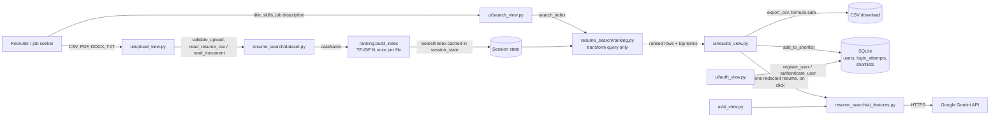

# Architecture

Resume Search has two layers:

- **`resume_search/`** — the core package. Pure Python, no Streamlit import. It reads datasets,
  extracts skills and experience, builds the TF-IDF index, ranks resumes, explains scores, exports
  CSV, stores accounts and shortlists in SQLite, and calls Gemini.
- **`ui/`** — Streamlit screens. They call only the public functions of `resume_search`, keep
  per-browser state in `st.session_state`, and render HTML only through the escaping helpers in
  `ui/components.py`. All CSS lives in `ui/styles.css`.

`app.py` is a thin entry point: page config, theme, database initialisation, session timeout and
routing to a screen.

## Data flow

## Ranking

1. The query is the job title, the requested skills and (optionally) a pasted job description,
   normalised by `text.normalize_text` — the same function used for every resume.
2. `build_index` fits a `TfidfVectorizer` (English stop words, word tokens) once per dataset.
3. Each search transforms only the query and takes the dot product with the L2-normalised document
   matrix, which equals cosine similarity.
4. Filters (minimum experience, include unknown experience) are applied, the top *k* rows are kept
   with a stable sort, and matched/missing skills are computed only for those rows.
5. "Why this score" lists the query terms whose TF-IDF products add up to the score.
6. Optional hybrid mode mixes 0.5 × TF-IDF with 0.5 × sentence-embedding cosine
   (`all-MiniLM-L6-v2`) when `sentence-transformers` is installed.

## Storage

| Data | Where | Lifetime |
|------|-------|----------|
| Accounts (e-mail, name, role, PBKDF2 hash, iteration count) | SQLite `users` | Until deleted |
| Failed sign-in counters and lock times | SQLite `login_attempts` | Reset on success / expiry |
| Shortlists (candidate label, score, matched skills, dataset name) | SQLite `shortlists`, `shortlist_items` | Until the user deletes them or clears their data |
| Uploaded dataset, index, results, AI output | `st.session_state` (memory) | Until sign-out, timeout or browser session end |

The database path is `RESUME_SEARCH_DB` (default `resume_search.db` in the project root).
